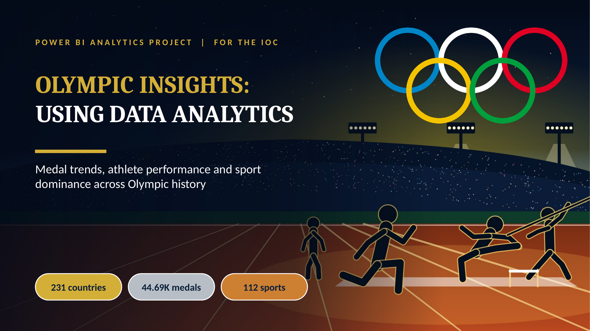

<h1 align="center">Olympic Insights Using Data Analytics — Power BI Navigational Dashboard</h1>

<p align="center">
  
  
  
  
</p>

<p align="center">
  
</p>

## Overview

A multi-page Power BI dashboard with navigation buttons, built on historical Olympic Games data. The International Olympic Committee wants deeper insight into athlete performance, country-wise medal trends and sport-specific dominance, to track achievements, evaluate performance KPIs and plan athlete development. The report spans six connected pages:

- **Global Medal Overview** — total medals, participating countries, top countries and medal trends over the years
- **Country Insights** — athletes, medals, medal efficiency, medal split and best sports for a selected country
- **Athlete Spotlight** — top medal winners, medal-winning versus total athletes, appearances, age at medal wins and gender split
- **Sport & Event Analysis** — sports and events, top sports by medals, country dominance and sport-wise trends
- **Host Country Analysis** — Olympics hosted, host versus non-host medal counts and events in host years
- **Gender & Demographics** — male versus female participation, gender-wise medals, youngest and oldest winners and age profile

## KPIs Tracked

| Page | KPIs and metrics |
|---|---|
| 1. Global Medal Overview | Total medals awarded · Total countries participated · Top 10 countries by total medals · Medal trends over the years · Year-wise total events held |
| 2. Country Insights | Total athletes represented · Total medals won · **Medal efficiency (medals per 100 athletes)** · Medal distribution (gold, silver, bronze) · Year-wise medal count for the country · Best-performing sports by country |
| 3. Athlete Spotlight | Total athletes · Top 10 athletes by total medals · Medal-winning athletes vs. total athletes · Most participated athletes (Olympic appearances) · Athlete age distribution at medal wins · Gender distribution of medal winners |
| 4. Sport & Event Analysis | Total sports and events · Events added per year · Top sports by medals awarded · Country dominance in sports · Sport-wise athlete participation · Sport-wise medal trends over time |
| 5. Host Country Analysis | Total Olympics hosted per country · Medal count as host vs. non-host · Host country medal trend · Events conducted in host Olympics |
| 6. Gender & Demographics | Male vs. female athlete count over the years · Gender-wise medal distribution · Youngest and oldest medal winners · Average age of participants by year · Participation by age group |

*KPI values are not listed here because they come from the dataset. All KPIs are intended to recalculate live through slicers.*

## Navigation

Every page carries a navigation bar with buttons linking to the other five pages, so a viewer can move between them without the page tabs. Slicers (for example year, country, sport and gender) filter the visuals on each page.

## Tech Stack

```
Microsoft Power BI
├── Power Query      → Ingestion and cleaning of the Olympic Games files
├── Data Modelling   → Linked tables for athletes, medals, events and host cities
├── DAX              → Measures such as medal efficiency (medals ÷ athletes × 100)
├── Navigation       → Page navigation buttons on every page
└── Report Pages     → Medals · Countries · Athletes · Sports · Hosts · Demographics
```

*Adjust this block to match what you actually built.*

## Pages Inside the Dashboard

| Page | Purpose |
|---|---|
| Global Medal Overview | A top-level view of medal totals, participation and how medals have trended over the years |
| Country Insights | Drill into one country: efficiency, medal mix, yearly trend and strongest sports |
| Athlete Spotlight | Highlight the most decorated and most frequent athletes, and who actually wins medals |
| Sport & Event Analysis | Compare sports by medals, participation and growth, and see which countries dominate each |
| Host Country Analysis | Test whether hosting changes a country's medal count and how events change in host years |
| Gender & Demographics | Track participation and medals by gender and age across the years |

## How to Use

1. Open the presentation (PPT/PDF) in this repository for page-by-page screenshots and explanations.
2. Use the navigation buttons shown on each page to move between the six pages.
3. Use the slicers to filter by year, country, sport and gender.

*The submission is a PPT/PDF, as no `.pbix` file is accepted.*

## Repository Structure

```
olympic-insights-power-bi
├── Olympic_Insights_Dashboard.pdf   ← Dashboard walkthrough, PPT or PDF (add your file here)
├── cover.png                        ← Repo cover image
└── README.md
```

---

## About Me

**Anmol Agarwal**
Business Analyst

[](https://www.linkedin.com/in/anmol-agarwal123/)
[](https://github.com/Anmolagarwal19)
[](mailto:agarwalanmol799@gmail.com)

*If this project was useful, a star on the repo is appreciated — feel free to reach out for feedback, questions, or opportunities.*
